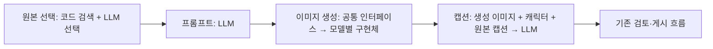

# 레퍼런스 기반 게시물 생성 Agent — 전체 개발 계획

- 날짜: 2026-10-19
- 상태: 구현·main 병합·개발 배포 완료. source_caption 정본 DDL은 후속 승인으로 개발 DB에 적용했다. DB 동시성 E2E와 실제 생성 공급자 검증은 보류한다. 아래 구현 당시 보류 기록보다 마지막 배포 기록이 우선한다.
- 구현 대상: OPOD Admin의 신규 Agent `reference-v1`.
- 사용자: 기존 권한을 가진 Admin 운영자.
- 진입: 게시물 생성 화면에서 캐릭터와 레퍼런스 기반 Agent를 선택하고 시작.

## 설계 정본

1. [참조 이미지 선택](2026-10-19-reference-agent-stage-1.md)
2. [프롬프트·negative 작성](2026-10-19-reference-agent-stage-2.md)
3. [이미지 생성](2026-10-19-reference-agent-stage-3.md)
4. [원본 캡션 참고 및 새 캡션 작성](2026-10-19-reference-agent-stage-4.md)

## 확정 결정과 범위

| 결정 | 출처 | 상태 |
| --- | --- | --- |
| characters → character_influencers → influencers → influencer_media 사용 | user-confirmed | active |
| 수집은 별도 작업, 생성 Agent는 저장된 자료 사용 | user-confirmed | active |
| 원본 선택 → 프롬프트 → 이미지 생성 → 캡션의 4단계 | user-confirmed | active |
| 원본 선택 Agent가 1~3컷 결정. 후보는 회당 12장, 기본 1회이며 최대 3회 설정 지원 | user-confirmed (2026-10-19 후속 승인) | active |
| 동일 원본 재사용 제외. 같은 구도·포즈·장소는 허용 | user-confirmed | active |
| 원본 구도·포즈 참고, 캐릭터 정체성 적용, 배경·의상 필요시 조정 | user-confirmed | active |
| negativePrompt 포함 | user-confirmed | active |
| 공통 이미지 생성 추상 → 설정별 구현체 → 모델별 조립 | user-confirmed | active |
| 원본 캡션은 맥락 참고, 복사·단순 치환·작성자 사실 전이 금지 | user-confirmed | active |
| 기존 Agent는 소스 보관 및 과거 초안 읽기 전용, 자연형 Agent·인증·수동/자동 게시 유지 | user-confirmed (후속 승인) | active |
| 별도 post_plan, 의미적 중복 감점, 별도 미디어 검색 인덱스 테이블 | 기존 제안 폐기 | superseded |
| 재압축 동일 이미지 인식, 원본 사용 이력 backfill, 수집 Work 변경, 별도 사진 LLM 검수 | 이번 범위 밖 | deferred |

A의 nullable 캡션 컬럼과 등록·조회 계약은 사용자 승인 후 구현하고 정확한 DDL을 작성했다.
사용자는 이후 끝까지 구현을 승인했으며 reference 전용 설정을 명시적으로 저장하고
초안에 고정하는 방식으로 구현했다. UI의 기존 Agent만 보관하고 natural-v1을 유지한다.
DB 적용과 E2E는 사용자 지시로 보류한다. 구현과 mock 계약 검증은 실제 DB·공급자
검증이나 배포 완료를 의미하지 않는다.

## 현재 코드와 재사용 소유자

| 기능 | owner check | 기존 소유자와 확인 근거 |
| --- | --- | --- |
| 계정 연결·미디어 저장 | owner-found | src/influencers/의 테이블별 Service/Repository, 등록 ApplicationService 및 influencer-media.e2e-spec.ts |
| 분석 저장·임베딩 | owner-found | influencer-input.ts의 analysis/compositionText, 등록 서비스의 ReferenceEmbeddingClient 호출, influencer-input.spec.ts |
| 캐릭터 컨셉/정체성 | owner-found | CharacterContentProfileService.get, VisualProfileService.getProfile와 기존 pipeline/worker 호출 |
| 캐릭터별 수집 미디어 벡터 검색 | owner-found(확장) | InfluencerMediaService/Repository가 테이블 소유. 현재 list/find만 있고 신규 검색 메서드 필요 |
| 원본 선택·참조 프롬프트 계약 | owner-absent | 기존 image-planner는 identity/environment 계약. source 기반 선택·실제 이미지 입력 계약은 신규 추가 |
| 생성 제출/상태/저장 | owner-found | GenerationWorkerService, ImageGenerationProvider, resolveImageGenerationProviders, 생성 검증·저장 함수와 provider spec |
| 캡션 작성/응답 검증 | owner-found | CaptionWriterAgent, captionUserContent, parseCaptionSet와 caption-writer.spec.ts |
| 단계 실행/설정/UI | owner-found | PostPipelineV3Runner, DraftsService, GenerationSettingsService, PostWorkPage/PostAgentsPage와 기존 spec |

이미 존재하는 수집 API·S3 저장·분석 등록·임베딩 처리를 다시 만들지 않는다. 현재 임베딩은 compositionText 기반으로 구도·포즈 등의 탐색에 적합하며 배경·의상·스타일 전반을 정확히 순위화한다고 주장하지 않는다. 후보의 최종 적합성은 실제 픽셀을 본 LLM이 판단한다. 기존 임베딩 원문 변경과 전체 재색인은 이번 범위에서 제외한다.

## 데이터와 계약 변경

### 공용 원본 데이터

- 원본 캡션용 influencer_media.sourceCaption(nullable text)과 등록/조회 API의 선택적 필드를 사용자 승인 후 추가했다.
- 같은 influencerId + postId의 캡션 갱신 일관성 및 누락/null/빈 문자열 처리는 4단계 계약을 따른다.
- influencer_posts, 공용 분석 이력 테이블, 별도 reference_library_image_index는 추가하지 않는다.
- 정본은 opod-service-backend/src/core/database/schema.ts와 backend migration, Admin schema는 mirror.
- 사용자 승인 범위는 코드 구현과 아래 정확한 DDL 작성 및 일회용 테스트 DB 적용이다. DDL은 생성했지만 사용자의 후속 요청에 따라 테스트 DB를 포함한 모든 DB 적용과 E2E는 보류했다. B~F의 코드와 추가 DDL은 별도 승인 대상이다. 개발 DB·영속 로컬 DB 적용과 배포는 승인 범위 밖이다.
- 작성한 정본: backend drizzle/20261019060222_orange_warlock/migration.sql 및 snapshot. SQL: `ALTER TABLE "opod"."influencer_media" ADD COLUMN "source_caption" text;`

### 초안별 결과

기존 post_drafts.concept_json과 generation job params에 버전이 있는 reference 전용 artifact를 추가한다. 기존 postPlan/imagePlan을 가짜로 채우지 않는다.
- referenceSelection: 검색 범위/조건, 후보·선택 ID/해시/출처, 컷 순서, 선택 근거.
- promptBuild: 컷별 source/identity 참조 매핑·순서, prompt/negative, 모델/설정, 리비전.
- generation: 기존 job/media 연결과 실제 전송 요청/진행 상태.
- captionBuild: 현재 생성 이미지 집합, 원본 캡션 스냅샷과 컷 연결, 기존 CaptionSet 결과.

미디어 ID 종류를 분리한다. influencer_media의 BIGINT ID를 기존 media UUID로 해석하지 않는다. typed source discriminator와 서버에서 검증한 S3 키로 읽고 기존 로그/요청 메타데이터에서도 출처 종류를 보존한다.

## 개발 순서 — 관찰 가능한 기능별 묶음

아래 경로는 opod-admin 기준이며 backend 정본 경로만 따로 명시한다. 신규 경로는 계획상 이름이다. 각 묶음에 직접 관련된 문서와 테스트를 함께 포함한다.

### A. 원본 캡션을 등록하고 조회할 수 있다

- [x] 파일: backend src/core/database/schema.ts 및 승인된 새 drizzle migration; Admin src/core/database/schema.ts, src/influencers/influencer-input.ts, influencer-media.repository.ts, influencer-media-application.service.ts. 기존 influencer-media.service.ts는 변경 없이 재사용한다.
- [x] 등록 API의 optional sourceCaption과 같은 게시물 슬라이드 간 일관성을 구현한다. 재등록에서 미전달 값은 보존하고, 캡션만 바뀌면 기존 구도 임베딩을 유지한다.
- [x] docs/api/admin-influencers.md에 수집 담당자가 전달할 필드·빈 값 의미·조회 계약을 기록한다. 수집 담당자의 실제 캡션 수집/backfill은 별도 연동 의존성이다.
- 구현 결과: raw/null/빈 문자열 계약, 게시물별 advisory lock과 슬라이드 전파·상속, POST/GET 응답, 임베딩 보존을 구현했다. 실제 DB 동작은 아직 검증하지 않았다.
- 검증: `npm run test -- --runInBand --runTestsByPath src/influencers/influencer-input.spec.ts`; `npm run test:e2e -- --runTestsByPath test/influencer-media.e2e-spec.ts`; `npm run schema:check`.
- [x] backend migration 생성 및 정확한 단일 ADD COLUMN 문장 검토, Admin schema mirror 확인.
- [x] 입력 focused 11개 테스트, Admin lint/server TypeScript, backend build, schema:check 통과. 최종 전체 Admin 단위 테스트 62 suites/727 tests와 focused 11개를 통과했다. 관련 테스트/setup 파일 formatting도 통과했다.
- [x] raw/누락/null/빈 문자열, 새 게시물 동시 최초 삽입, 슬라이드 전파·상속, 계정/게시물 격리, 식별자 충돌, 임베딩 보존, multipart 바이트 제한의 E2E 계약 작성 및 TypeScript 검사.
- [ ] 일회용 테스트 DB에 migration 적용 및 influencer-media E2E 통과 확인. Docker가 응답하지 않았고 사용자가 재시작을 거절하여 보류했다. 실행 시도는 중단했으며 어느 DB에도 DDL을 적용하지 않았다.
- [ ] A 전체 인수 조건의 실제 DB 검증 완료. S3 adapter와 임베딩 외부 HTTP는 E2E에서 대체하므로 실제 공급자 검증과 구분한다.
- 검증 제한: 전체 UI check/build는 기존 동시 작업의 누락 module/export로 실패했고 전체 format은 기존 dirty 코드에서 실패했다. 관련 없는 파일은 수정하지 않았다. 개발 DB·영속 로컬 DB 적용, 배포, 실제 S3/LLM 호출, 커밋은 수행하지 않았다.

### B. 신규 Agent를 선택하면 적합한 원본이 자동 선택된다

- [x] `reference-selection.ts`의 후보 12장·기본 1회·최대 3회, ID/SHA 중복 제외, 유효 no_match만 추가 탐색, 1~3장 자동 선택 계약.
- [x] `InfluencerReferenceRetrievalService`가 연결 계정·동일 composition 임베딩 모델의 준비된 이미지 후보를 조회하고 실제 게시 원본 ID/SHA와 이미 본 후보를 제외한다.
- [x] `ReferenceSelectionAgent`에 실제 후보 픽셀과 캐릭터/요청을 전달하고 선택 이유·sourceCaption·파일 SHA·로그 ID를 `referenceSelection`에 저장한다.
- [x] `DraftsService`/DTO/작업 UI가 명시적 reference 생성과 `reference_select` 시작을 연결한다. post_plan/image_plan을 만들거나 실행하지 않는다.
- [ ] 실제 DB 검색·원본 사용 이력 격리와 실제 픽셀/임베딩 공급자 적합성 검증. DB E2E와 live provider는 보류한다.

### C. 선택 원본과 캐릭터 이미지로 prompt/negative가 작성된다

- [x] `prompts/reference-image-prompt.ts`, `ReferenceImagePromptAgent`, `ReferencePostAgentRunner`를 연결했다.
- [x] 원본/캐릭터 픽셀·SHA·역할과 모델별 promptLabel 순서를 고정하고 컷별 prompt/negative·유지/조정 요약과 producerLogId를 저장한다.
- [x] ID·순서·파일 SHA·누락 컷·blocked·모델 참조 수 제한을 검증한다. 설정 지침/schema/모델은 초안의 referenceAgentConfig를 사용한다.
- [ ] 실제 모델이 구도와 캐릭터 정체성을 보존하는지 비교. mock 계약을 사진 품질 검증으로 간주하지 않는다.

### D. 모델별 구현체가 요청을 조립해 이미지를 생성한다

- [x] `GenerationService.ensureReferenceDraftJobs`와 소유 Repository가 prompt revision별 job ID를 재사용하고 `_referenceAgent` snapshot에 prompt/negative·정렬 참조·SHA·모델·생성 파라미터를 저장한다.
- [x] `GenerationWorkerService`가 snapshot만으로 요청을 조립하고 실제 참조 SHA를 검사한다. 현재 config를 다시 읽어 원래 입력을 바꾸지 않는다.
- [x] 공통 submit/poll·외부 providerRequestId·이미지 검증/저장을 재사용한다. Qwen 등 지원 모델은 negative 필드로, 미지원 모델은 해당 provider에서 본문에 병합한다. 원문과 실제 전송 payload는 로그에 구분한다.
- [x] 현재 generationBuild.jobIds와 prompt revision의 전체 완료만 caption으로 넘긴다. 실패한 현재 컷의 retry는 같은 입력/잡을 재사용하며 완료 컷은 재생성하지 않는다.
- [ ] 실제 외부 ID 재개·공급자별 payload 수락·이미지 출력 검증. DB E2E/live provider는 실행하지 않았다.

### E. 원본 캡션을 참고한 새 캡션으로 초안이 완성된다

- [x] `CaptionWriterInput`의 reference variant와 `prompts/reference-caption.ts`를 구현했다. 기존 자연형 입력·CaptionSet 파서를 유지한다.
- [x] 생성 이미지 전체·캐릭터·운영자 요청과 원본 선택 당시 sourceCaption을 계정+게시물별로 묶어 컷에 연결한다. null/빈 값은 보존하고 없는 캡션도 허용한다.
- [x] 캡션 입력과 생성 집합 해시/prompt revision, expectedOutputs/CAS로 늦거나 변경된 결과를 거부한다. 성공 시 needs_review로 전환하며 실패는 캡션만 재실행한다.
- [ ] 실제 캡션의 복사·단순 치환·원본 작성자 사실 전이 여부 품질 비교. 자동 파서는 의미적 독립성을 보증하지 않는다.

### F. 설정·재실행·게시까지 운영 흐름을 완성한다

- [x] `GET/POST post-generation-agents/reference/config`와 ReferenceAgentPanel을 연결했다. batch12/maxAttempts1~3, 세 단계 지침/LLM 모델과 공통 generation 저장 버전을 UUID revision/CAS로 저장하고 새 초안에 고정한다.
- [x] `DraftsModule`/`GenerationModule`이 소유 Domain Service를 export하고 `PostProductionModule`이 reference runner와 DraftWorker를 조합한다. 신규 orchestration은 Repository를 직접 주입하지 않는다.
- [x] reference 단계 실행은 expectedStage와 expectedRevision(draft.updatedAt)을 확인한다. 설정 UUID revision은 별도로 snapshot에 고정한다. UI의 다음 버튼은 단계 이동이며 실행·실패 컷 재시도·캡션 편집·승인/게시는 별도 동작이다.
- [x] 수동/자동 reference 게시는 동일한 DraftsService 출판 claim을 거친다. 소유 Repository가 캐릭터 advisory lock/초안 행 잠금 아래 실제 게시 또는 유효 예약 원본 ID/SHA를 검사하고 publication lease를 잡는다.
- [x] `POST drafts/:id/reference/restart`의 reference_select target이 원본과 후속 prompt/generation/caption artifact 및 기존 승인을 무효화하고 원본 선택 pending으로 되돌린다.
- [x] 같은 endpoint의 generation target은 저장 원본·prompt/negative·참조·모델/config 입력을 보존하고 prompt revision을 올려 새 job ID 집합으로 생성·캡션을 다시 진행한다. currentReferenceOutputs는 `reference-post-artifacts.ts`가 소유한다.
- [ ] 실제 DB 동시 claim·예약 만료·중복 원본 게시 차단·트랜잭션 롤백 검증. SQL 구현만으로 완료 처리하지 않는다.
- [x] UI의 기존 Agent만 활성 구현에서 제거하고 `archive/existing-agent/2026-10-19/`에 원문 snapshot/manifest를 보관했다. 기존/식별자 없는 초안은 변경·실행·자동화·게시가 차단되고 ArchivedAgentWorkView에서 저장 결과와 로그를 조회한다. 자연형 Agent와 독립 이미지 위저드는 유지한다.
- [ ] 최종 전체 검사 결과와 사용자 인수 상태 확정. 현재 문서는 구현 증거만 기록하며 최종 완료를 주장하지 않는다.

검증 owner: reference selection/prompt/runner 및 caption spec, generation snapshot/worker/provider spec,
reference publication/HTTP 계약 spec, PostWorkPage/ReferenceAgentWorkView/ReferenceAgentPanel UI 테스트.
DB 테스트에는 원본 sourceCaption 동시 갱신·검색 범위·잠금/게시 경합을 포함해야 한다.
테스트 DB DDL 적용·DB E2E·실제 S3/임베딩/LLM/이미지 공급자 실행은 보류한다.

## 실패·권한·데이터 규칙

- 기존 Admin 인증/CSRF를 사용한다. 신규 외부 토큰 체계나 수집 서비스 권한을 만들지 않는다.
- 연결 계정 없음, 미디어 없음, 검색 준비 미완료, 적합 후보 없음, S3 접근 실패를 구분한다. 403/타임아웃을 빈 검색으로 취급하지 않는다.
- 모든 선택·파일 접근은 서버가 허용한 후보 ID/연결 범위 안에서 수행한다. LLM이 반환한 임의 S3 키나 외부 URL을 사용하지 않는다.
- 원본과 공유 수집 미디어는 읽기 사용하며 계정 연결 해제나 초안 삭제로 공유 파일을 지우지 않는다.
- 원본 사용 기록 없는 과거 게시물은 미사용 보장이 불가능하다. 신규 Agent가 남기는 provenance부터 확실히 검사한다.
- 게시 이력의 동시성 검증은 실제 DB 테스트로 확인한다. 단위 mock만으로 보장하지 않는다.

## 최종 검증과 문서화

테스트는 위 인수 조건을 보호하는 것만 추가한다. mock 테스트는 계약·상태·요청 조립을 확인하고 실제 생성 품질을 보장하지 않는다. 실제 샘플로 같은 장소/포즈 후보 허용, 원본 구도와 캐릭터 정체성 반영, negative 전달, 원본 캡션의 복사·단순 치환·사실 전이 여부를 확인한다. 실제 모델 실행은 구현 검증 단계에서 설정과 비용 범위를 확인한 뒤 수행한다.

구현 완료 후 docs/07-codebase-guide.md, docs/api/admin-post-generation-agents.md, docs/api/admin-influencers.md 및 docs/caption-writing.md에 검증된 소유권·계약만 반영한다. 계획을 현재 구현 사실로 기록하지 않는다. 기능별 변경과 직접 관련 문서는 같은 커밋, 샘플 생성 결과는 별도 기록으로 분리한다.

## 승인 및 현재 상태

- 사용자가 B~F를 끝까지 구현하도록 승인했고 원본 자동 1~3컷·회당 12장·기본 1회·최대 3회를 확정했다. reference 설정은 별도로 명시 저장하고 초안에 snapshot하는 방식을 적용했다.
- 원본 선택 → 프롬프트 → 생성 → 캡션 네 단계의 runtime과 상세 UI가 연결되어 있다. 로그는 실행 당시 producerLogId/request/type/job으로 읽고 이후 편집값으로 재구성하지 않는다. 이미지/캡션/원본 조회는 저장 ID·SHA와 연결 범위를 재검사한다.
- 기존 Agent 보관의 범위는 UI의 `existing` 및 식별자 없는 과거 초안이다. natural-v1은 보존한다. DB 행·로그·산출물을 지우지 않고 실행·변경만 차단한다. archive `.snapshot`은 컴파일/테스트/실행 대상 밖에 둔다.
- 성공 후 원본 재선택·같은 입력 전체 재생성은 timestamp revision guard와 활성 잡/lease·게시/거절 상태 검사를 포함해 구현하고 관련 focused 회귀를 확인했다. 실패 컷 retry와 구분하며 최종 전체 검증은 별도 기록한다.
- DB 검증은 사용자 지시로 보류했다. 어느 DB에도 이번 sourceCaption DDL을 적용하지 않았고 DB E2E·실제 공급자·배포·커밋은 수행하지 않았다. 원본 사용 이력 검사와 예약 SQL의 실제 동시성 검증도 이 범주다.
- 단위/HTTP mock/fixture UI 검증은 계약·요청·상태 전이를 보호한다. 실제 생성 사진과 캡션 품질 또는 DB locking의 증거로 취급하지 않는다. 최종 전체 테스트 수·통합 검증 결과는 부모의 최종 검증 후 별도로 기록한다.

## 최종 구현 검증 — 2026-10-19

- `npm run test -- --runInBand`: 77 suites / 863 tests 통과. HTTP 단위 테스트의 로컬 포트 권한만 허용했고 실제 DB·외부 모델은 사용하지 않았다.
- `npm run lint`, `npm run format`, `npm run build`, `npm run schema:check`: 통과. 마지막 변경 후 서버·UI TypeScript와 실제 Nest 모듈 DI 구성도 확인했다.
- `npm run admin:check`: TypeScript 통과, 28 suites / 135 tests 통과. 범위 밖 동시 변경인 `CharacterReferenceLinksPanel` 2개와 `CharacterSnsPage` 5개 테스트가 실패했고 해당 라우터의 미처리 오류 2개가 보고됐다. 신규 Agent와 게시물 관련 테스트는 통과했다.
- 모든 API·외부 요청을 fixture로 차단한 Chrome에서 4단계, 우측 상단 CTA, 실제 저장 로그의 입·출력, 2장 미리보기, 설정·보관 화면, 390px 모바일 가로 넘침을 확인했다. 추가 재시작·수동 워커 버튼은 UI 계약 테스트로 확인했다.
- Sol 6.1 하위 에이전트가 설정, 4단계 실행, 이미지 구현체 경계, 기존 Agent 보관, UI·문서·회귀 검증을 분담했다. 독립 리뷰의 수동 워커 OFF 실행/집계 문제를 수정하고 회귀 테스트를 추가했다. 재선택 뒤 이전 잡의 오류·썸네일을 노출하던 조회 문제도 현재 generationBuild ID 필터로 수정했다.
- 보관 manifest의 원본 snapshot 29개 SHA-256 무결성을 확인했다. 개발 DB·Docker 재시작·DDL 적용·DB E2E·실제 공급자 호출·배포·커밋은 수행하지 않았다.
- 검증 완료 범위는 코드·mock 계약·UI fixture다. 병합 전 사람 검토 대상은 `DraftsRepository`의 원본 게시 예약/재시작 잠금, 기존 게시 트랜잭션의 동일 잠금·lease 검사, 이미지 모델별 실제 요청이다. 실제 DB 동시성과 실제 사진·캡션 품질은 아직 검증하지 않았다.
- Knowledge Delta: 별도 reference runner와 공용 Drafts/Generation 모듈 소유권, 설정 snapshot/CAS, 원본 ID·SHA 사용 이력, reference 재시작 계약, existing 보관 규칙을 소스·사용자 승인 근거로 `docs/07-codebase-guide.md`, `docs/api/admin-post-generation-agents.md`, `docs/caption-writing.md`에 반영했다.

## 2026-10-19 최종 main 배포

사용자가 전체 변경의 main 병합·푸시·배포, 개발 DB 컬럼 추가와 백업 생략을 명시 승인했다. Admin `aa5662c`, Backend `668e3fb`를 배포했고 두 서비스 health와 로그인된 Admin의 수집 미디어·레퍼런스 설정 화면을 확인했다. 상세 증거와 검증 한계는 [배포 기록](../../../docs/03-deployment-rules.md)을 따른다.

전체 변경 기준 서버 863개·UI 142개 테스트 및 build/lint/format/schema:check 통과. Sol 6.1 subagent는 기존 UI 테스트 경로를 수정하고 원본 선택 starter 오류를 승인된 프롬프트 원문으로 복구했다. 메인 에이전트가 diff·전체 검증·최종 서버 화면을 재확인했다. 실제 생성 호출과 DB 잠금 경합 테스트는 수행하지 않았다.

Knowledge Delta: 후속 사용자 승인과 서버 검증에 근거해 DDL·main 배포 상태를 docs/03-deployment-rules.md와 docs/07-codebase-guide.md에 반영했다. 기본 지침 오입력은 소유 상수와 기존 HTTP 계약 테스트에서 복구했고 별도 중복 troubleshooting 문서는 만들지 않았다.
