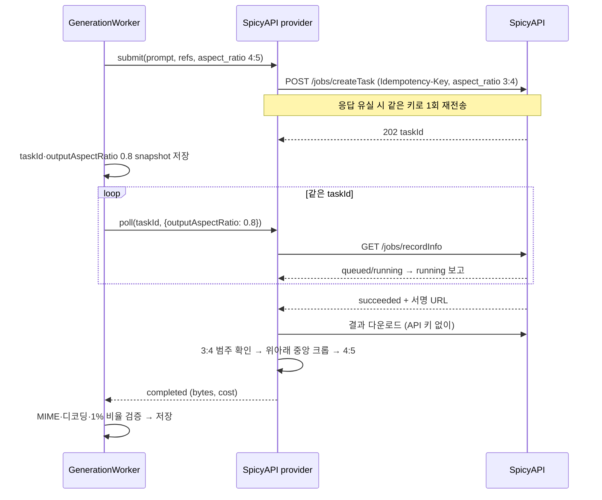

# SpicyAPI Qwen Image 3.0 연동

2026-10-15 사용자 결정으로 이미지 생성 공급자에 SpicyAPI의 Qwen Image 3.0 Pro(기본)와
Qwen Image 3.0을 추가했다. 현재 OpenAI `gpt-image-2.5-sunburst`는 테스트용이며,
10/13 이후 39건 중 12건이 `sexual` 판정으로 차단됐다
([단계별 입·출력 평가](post-agent-stage-io-review-2026-10-15.md) §4). 모든 캐릭터를
SpicyAPI로 옮길 예정이며, 실제 전환은 키 등록 뒤 운영자가 아래 절차로 한다.

## 현재 프롬프트 확장 정책 (2026-10-21)

사용자 결정으로 Qwen Image 3.0·3.0 Pro의 edit/t2i 요청은
`enable_prompt_expansion: true`로 전송한다. 아래 2026-10-15의 확장 OFF 결정은
이 정책으로 대체한다. 배포 후 새로 제출하는 요청부터 적용하며 입력 프롬프트를
공급자가 다시 쓸 수 있다. 얼굴 유사도 개선이나 공급자 내부 thinking 활성화는
보장하지 않는다. Seedream 요청 형식은 유지한다.

## 최초 결정 (2026-10-15)

| 항목 | 결정 | 근거·대안 |
| --- | --- | --- |
| 모델 | `alibaba/qwen-image-3.0-pro/edit`(기본), `alibaba/qwen-image-3.0/edit`. 레퍼런스 없는 컷은 같은 계열의 `/text-to-image` | 두 모델은 요청 형식이 같고 가격만 다르다(Pro 1k $0.04·2k $0.075, 표준 $0.03). 정체성 유지 비교 자료가 없어 둘 다 등록하고 파일럿으로 고른다. |
| 기본 파라미터 | `resolution: "1k"`, `enable_prompt_expansion: false`, `num_outputs: 1` | 프롬프트 확장은 정밀한 장면 지시를 다시 쓴다(모델 문서 권고). 2k는 생성 파라미터 `resolution`으로만 바꾼다. |
| 4:5 비율 | 가장 가까운 지원 비율(4:5 → 3:4)로 생성하고, 넘치는 축만 가운데에서 잘라 정확히 4:5로 맞춘다 | API의 `aspect_ratio`에 4:5가 없다. 기획·프롬프트·설정은 4:5 그대로다. 대안이던 3:4 게시나 Alibaba 직접 연동은 채택하지 않았다. |
| 실패 처리 | 자동 재제출 없음. failed·expired·content_rejected·조회 404는 terminal 실패 | 접수된 작업은 취소할 수 없고 성공하면 과금된다. |
| 네거티브 | 정책 `usesNegativePrompt=false`, 제외 조건은 본문 | 프롬프트 생성 계약이 true일 때 모든 컷에 네거티브를 강제하고 4,000자까지 허용한다(API 2,000자). 아래 위험 참조. |
| 레퍼런스 상한 | edit 모델의 컷당 상한(3)을 이미지 기획 입력 `maxReferencesPerShot`으로 전달하고 초과 응답을 기획 단계에서 거부 | 기존에는 프롬프트 단계가 `unsupported_plan/too_many_references`로 멈췄다. 상한을 넘는 레퍼런스를 몰래 버리는 대안은 기획이 고른 근거를 잃어 채택하지 않았다. |

## 흐름

- 크롭 기준은 워커가 제출 때 저장한 `_shot.execution.outputAspectRatio`이므로 재시작
  뒤에도 같다. 결과가 요청한 지원 비율 범주가 아니면(예: 세로 요청에 가로 결과)
  자르지 않고 `generated_image_invalid`로 끝낸다. 정확히 맞는 결과는 바이트를 바꾸지
  않는다.
- 자른 결과는 원본 형식을 유지한다(PNG는 무손실, WebP는 lossless, JPEG는 품질 95).
  원본·결과 크기와 생성 비율은 이미지 생성 로그 응답의 `opodPostprocess.images`에 남는다.
  서명 URL의 쿼리와 API 키는 로그에 남지 않는다.
- 결과 다운로드·조회의 일시 오류는 같은 taskId로 다음 시도에서 이어 조회한다.
  비용은 정산된(`settled`) 작업의 `cost`를 잡에 기록한다.

## 운영자 전환 절차 (키 등록 뒤)

1. 관리 화면 설정 → 생성 및 AI 연결 → 이미지 생성에서 실행 provider를 SpicyAPI로
   고르고 SpicyAPI 키를 입력한다. 이미지 모델은 Qwen Image 3.0 Pro가 기본이다.
   연결 테스트는 무료 모델 조회이며 생성 성공을 보장하지 않는다. 저장하면 Agent
   버전이 없는 경로의 기본 공급자도 SpicyAPI가 된다. 키만 저장하고 기본 공급자를
   되돌려도 키는 남는다.
2. Agent 관리 → "모델 관리"에서 모델 유형 "이미지", 공급자 `spicyapi`, 모델명
   `alibaba/qwen-image-3.0-pro/edit`로 등록한다(비교용 `alibaba/qwen-image-3.0/edit`).
3. "새 Agent · 자연스러운 사진" 탭 → "이미지 생성 모델 변경" → "공통 이미지 생성 모델
   설정"에서 등록한 모델을 골라 저장한다. 새 generation 버전이 생기며 기존 Agent도
   이후 만드는 프롬프트부터 이 모델을 쓴다.
4. 같은 탭에서 새 Agent 설정을 다시 저장한다. 번들은 저장 시점의 generation 버전을
   고정하므로, "현재 새 Agent에 고정"이 `spicyapi / alibaba/qwen-image-3.0-pro/edit`로
   바뀌었는지 확인한다.
5. 이후 새로 만든 초안부터 SpicyAPI로 생성한다. 기존 초안·잡과 재생성은 저장된
   번들·`_postAgent` snapshot대로 OpenAI를 계속 쓴다.

파일럿은 캐릭터 2~3명으로 새 초안 몇 건을 만들어 확인한다(이미지당 Pro 1k $0.04에
레퍼런스 추가 요금). 확인 항목은 `content_rejected` 여부, 얼굴·체형 유지,
4:5 크롭 뒤 머리·발 잘림, 생성 로그의 `opodPostprocess`, 잡 비용이다.

## 사용자가 준비할 것

- SpicyAPI 계정(만 18세 이상, 이메일 인증)과 잔액 충전(카드 또는 암호화폐).
- API 키. 권장 제한은 모델 허용 목록(두 계열의 `/edit`·`/text-to-image` 4개)과
  일·월 지출 상한이다. 개발 서버의 공인 IP가 고정이면 IP 허용 목록도 쓴다.
- 키는 관리 화면에만 입력한다. 채팅·문서·로그에 붙여 넣지 않는다.
- 파일럿 비용 승인. 파일럿은 실제 캐릭터 레퍼런스를 SpicyAPI(와 모델 공급자)로 보낸다.

## 위험과 미검증

- **거부 여부:** SpicyAPI는 이 모델에 필터가 없다고 하지만, Qwen Image 3.0은 공개
  가중치가 없는 호스팅 모델이고 Alibaba API는 프롬프트를 검사한다. 성인 컷의
  `content_rejected` 비율은 파일럿 전까지 모른다.
- **정체성:** 모델 문서가 큰 편집에서 얼굴이 흔들린다고 경고한다. 새 장면 생성은 큰
  편집이다.
- **크롭:** 3:4에서 4:5로 높이의 6.25%를 위아래로 나눠 자른다. 프레임 끝에 둔 머리·발이
  잘릴 수 있다. 1k/2k의 실제 픽셀 크기는 공개되지 않았다(크롭은 크기와 무관하게 동작).
- **네거티브:** 제외 조건(예: 아동처럼 보이는 외형)을 본문에 쓰면 확산 모델이 그 개념을
  끌어들일 수 있다. 파일럿에서 관찰하고 필요하면 `negative_prompt` 계약을 따로 실험한다.
- **중복 과금:** 같은 시도 안의 응답 유실은 같은 키로 막는다. 두 번의 전송이 모두
  네트워크 오류이거나 제출 기록(DB)이 실패하면 다음 워커 시도는 새 키를 쓰므로, 첫
  요청이 실제로 접수됐다면 작업이 하나 더 생길 수 있다.
- **후보 수:** 요청당 1장이다. 후보 2장 이상을 요구하는 이전 경로는 과금 전에 실패한다.
  V4/natural-v1은 컷당 1장이다.
- **레퍼런스 전달:** 1시간짜리 S3 presigned HTTPS URL만 보낸다. S3 없는 로컬 개발은
  SpicyAPI를 쓸 수 없다.
- **기획 상한:** 저장된 이미지 기획 지침은 `maxReferencesPerShot`을 설명하지 않는다.
  모델이 무시하면 기획 단계에서 `invalid_agent_response`로 멈춘다.
- 결과 형식(PNG 예시), 레퍼런스당 추가 요금, 한국 지역 제공 여부(40303)는 확인하지
  못했다. 웹훅은 쓰지 않는다(공개 컨트롤러를 두지 않는 저장소 규칙).

## 검증 (2026-10-15)

- provider·설정·정책·기획 상한·모델 등록·화면 테스트를 추가했다. 실제 API는
  호출하지 않았고 fetch를 대체했다.
- 로컬 Docker가 없어 E2E는 실행하지 못했다.

## 배포 (2026-10-15)

- 13:2x KST 개발 서버에 배포했다. 이미지는 `opod-admin:spicyapi-20261015`, 롤백 이미지는 `opod-admin:stage-io-20261015`다.
- 배포 전에 메인 세션이 다시 검증했다: lint 통과, unit 683개, build, admin:check 105개. 로컬 Docker가 응답하지 않아 E2E는 돌리지 못했다.
- 배포 직후 상태:
  - 전역 이미지 provider는 `openai`, natural-v1 생성 모델은 `openai / gpt-image-2.5-sunburst` 그대로다.
  - `worker.enabled=false`이고 새 LLM 호출이나 잡은 없었다.
  - SpicyAPI 키는 아직 등록되지 않았다.
  - 실제 전환은 위 "운영자 전환 절차"를 따른다.

## 전환과 첫 시범 (2026-10-15)

전환:
- 14:02 KST에 사용자가 관리자 화면에서 키를 저장하고 전역 provider를 `spicyapi`로 바꿨다. 연결 테스트는 HTTP 200이었다.
- 14:13 KST에 사용자가 모델 목록에 Pro(`ai_models` 4)와 3.0(5)을 등록했다. 이어 이미지 생성 단계를 Pro로 저장했다(revision 2, id 31).
- 생성 단계를 저장해도 natural-v1 번들의 생성 모델 고정은 바뀌지 않는다. 번들은 "새 Agent 설정 저장" 시점의 생성 단계를 복사해 둔다. 이 상태에서 화면은 "저장된 버전 2"와 "현재 새 Agent에 고정: openai / …"를 함께 보여 줬고, 사용자는 이미 바뀐 것으로 읽었다.
- 사용자가 새 Agent 설정을 다시 저장해 번들이 `sha256:61cf60b6…`가 됐다. 직전 배포 번들(`sha256:dd9b4002…`)과 비교하면 `generation` 고정만 바뀌었다.
- 메인 세션의 전환 스크립트(`switch-spicyapi.cjs apply`)는 권한 검사에서 거부돼 실행하지 않았다.

시범:
- 해나·유하·나희에게 새 natural-v1 초안을 1개씩 만들었다(수동 모드, 운영자 요청 없음, 사진 1장).
- 컨테이너 안 스크립트가 서비스 메서드로 단계를 진행했다(`DRAFT_MAX_SHOTS=1`, 자동화 꺼짐 확인). 재생성과 게시는 하지 않았다.
- 세 초안 모두 캡션까지 끝나 게시 대기 상태다. 수동 초안이라 자동 게시 대상이 아니다.

| 캐릭터 | 장면 | 레퍼런스 | 결과 | 정산 비용 |
| --- | --- | --- | --- | --- |
| 나희 | 카페 창가, 브라운 V넥 니트 | 2 | succeeded, 40초 | $0.046 |
| 유하 | 집 드레스룸, 버건디 오프숄더 미니드레스 | 3(공간 1) | succeeded, 40초 | $0.049 |
| 해나 | 체육관 슬레드 푸시 | 3 | succeeded, 2분 | $0.049 |

관찰:
- **거부:** 0/3. OpenAI에서 차단되던 표현("cleavage", 의도적인 섹스어필)이 그대로 통과했다. 표본이 작아 업스트림 검열이 없다는 증거는 아니다.
- **얼굴:** 세 명 모두 유지됐다. 유하는 공간 레퍼런스의 방 배치(거울, 행거, 창, 책상)까지 잘 따랐다.
- **체형:** 나희·유하는 가슴이 체형 레퍼런스보다 크게 나왔다.
- **촬영자 노출:** 해나 사진 오른쪽 끝에 폰을 든 손이 보이고, 폰 화면에 해나가 비친다. 프롬프트의 "Another person takes … smartphone photograph"를 그대로 그린 것이다. 사진 검수는 이 폰을 관찰하고도 accept했다.
- **레퍼런스 자세 복사:** 나희는 얼굴 레퍼런스의 정면 자세와 미소를 거의 그대로 따랐다.
- **크롭:** 3:4 원본 864×1152에서 위아래 36px씩 잘라 864×1080을 저장했다. 머리·발이 잘린 경우는 없었다. 다만 폭 864px는 Instagram 권장 1080×1350보다 작다.

증거는 `content-work/spicyapi-pilot-20261015/`에 있다(단계 로그, provider 로그·프롬프트, 생성·레퍼런스 이미지, 비교 시트).

## Seedream 5.0 Pro 추가와 비교 (2026-10-15)

**배경.** 첫 시범 뒤 사용자는 Qwen 사진의 결이 OpenAI보다 크게 떨어진다고 판단했다. 같은 이미지에서 보이는 특징은 매끈하게 보정된 피부, 화보 조명, 인형 같은 얼굴이었다. 사용자는 Qwen 전용 금지 규칙으로 결함을 막는 방식을 거절했고(쓸데없는 제약), 같은 SpicyAPI의 다른 무검열 모델을 직접 등록해 비교하라고 했다.

**모델 선택.** SpicyAPI 카탈로그의 무검열 이미지 편집 모델 중 ByteDance Seedream 5.0 Pro를 골랐다.
- 판매처 표기는 "declares no content filter"다.
- 레퍼런스를 10장까지 받는다.
- 가격은 1k $0.036, 2k $0.072부터이고, 레퍼런스가 늘면 올라간다.

**구현** (`spicyapi-image.provider.ts`, `image-model-policies.ts`):
- `bytedance/seedream-5.0-pro/edit`를 허용 모델에 추가했다. 레퍼런스 없는 컷은 `/text-to-image`를 쓴다.
- provider는 계열(Qwen/Seedream)마다 요청을 따로 만든다. 두 schema 모두 `additionalProperties:false`라 schema에 없는 필드를 보내면 안 된다.
  - Qwen만 받는 입력: `num_outputs`, `enable_prompt_expansion`, `negative_prompt`, `seed`
  - Seedream만 받는 입력: `enable_thinking`
- Seedream 요청에는 negative를 보내지 않고 거부한다. `seed`는 버린다.
- 정책 `seedream-5-policy-v1`은 Qwen과 같은 형식 규칙 네 줄만 둔다. 레퍼런스 상한은 10이다.
- 설정 화면의 SpicyAPI 모델 선택지에 Seedream을 추가했다.
- 검증: lint, unit 690개, admin:check 105개, build 통과.
- 15:19 KST에 개발 서버에 배포했다. 이미지는 `opod-admin:seedream-20261015`, 롤백 이미지는 `opod-admin:spicyapi-20261015`다.
- 모델 목록 등록: `ai_models` 6. natural-v1 고정은 바꾸지 않았다(Qwen Pro 유지).

**배포 뒤 발견.** 처음 provider는 Seedream에 `aspect_ratio:"4:5"`와 `enable_thinking:false`를 함께 보냈고, 세 요청 모두 `40004`로 거부됐다. 작업은 생성되지 않았고 과금도 없었다. 무료 `POST /jobs/quote`로 조합을 확인한 결과:

| 조합 | 결과 |
| --- | --- |
| 4:5 + thinking false | 40004 (두 값 모두 "지금은 받지 않음") |
| 4:5 + thinking 기본(true) | 가능, $0.075 |
| 3:4 + thinking false | 가능, $0.075 |
| auto + thinking false | 가능, $0.075 |

그래서 두 방식을 모두 생성해 비교한다: (a) 4:5 + thinking 기본, (b) 3:4 + thinking false 뒤 4:5 중앙 크롭(Qwen과 같은 방식).

**비교 방법.**
- 첫 시범 세 초안(나희, 유하, 해나)이 Qwen에 실제로 보낸 프롬프트와 레퍼런스를 순서 그대로 다시 보냈다. 레퍼런스 URL은 새로 서명했다.
- 컨테이너 안 스크립트가 API만 호출했다. 초안, 잡, 설정, LLM 로그는 만들지 않았다.
- 조합은 Qwen Pro 1k(첫 시범), Qwen Pro 2k, Seedream (b), Seedream (a)이고, 모두 거부 없이 성공했다.

| 조합 | 출력 | 장당 비용 | 시간 |
| --- | --- | --- | --- |
| Qwen Pro 1k | 864×1152 → 864×1080 | $0.046~0.049 | 40초~2분 |
| Qwen Pro 2k | 1536×2048 → 1536×1920 | $0.081~0.084 | 73~135초 |
| Seedream (b) 3:4, thinking 끔 | 1728×2304 → 1728×2160 | $0.075~0.078 | 102~108초 |
| Seedream (a) 4:5, thinking 기본 | 1824×2288 → 1824×2280 | $0.075~0.078 | 69~119초 |

**관찰** (메인 세션의 눈 판정, 표본은 캐릭터당 1장):
- **해상도:** Qwen은 2k에서도 매끈한 보정 피부와 화보 조명이 그대로다. 결의 원인은 해상도가 아니라 모델이다.
- **사진 결:** Seedream은 두 방식 모두 피부 결, 창빛, 배경 깊이가 실제 폰 사진에 더 가깝다. (a)가 가장 자연스럽다.
- **얼굴 일치:** Qwen이 레퍼런스와 가장 가깝다. Seedream (b)는 비슷한 편이다. (a)는 나희 얼굴이 더 길고 날카로워져 다른 사람처럼 보이는 정도가 가장 크다. 유하는 (a)도 점, 단발, 안쪽 브라운 컬러가 유지됐다. 해나는 측면 동작이라 판단하기 어렵다.
- **촬영자 노출:** (b)는 나희와 해나에서 프롬프트의 "일행이 폰으로 찍는다"를 그대로 그려 앞쪽에 촬영자 뒤통수나 폰이 들어왔다(2/3). (a)는 3장 모두 촬영자를 그리지 않았다. Qwen은 1k 해나 1장에서만 그렸다.
- **레퍼런스 복사:** (b)는 유하 얼굴 레퍼런스의 파란 머리핀까지 옮겼다.
- **추정:** Qwen의 매끈한 결은 레퍼런스(AI 스튜디오 화보) 자체의 결을 충실히 옮긴 결과일 수 있다. Seedream은 레퍼런스에서 더 벗어나는 대신 사진 결이 자연스럽다.

**provider 상태.** 배포본은 Seedream에 4:5와 thinking false를 함께 보내므로, 지금 선택하면 생성이 `40004`로 실패한다. 과금은 없다. 고칠 방식은 사용자 결정 대기 중이다.

증거는 `content-work/spicyapi-pilot-20261015/compare/`에 있다(생성 이미지, 영수증, `compare-all.jpg`, `faces-all.jpg`). 스크립트는 세션 scratchpad의 `compare.cjs`, `compare2.cjs`, `probe.cjs`다.

## DB 공통 네거티브 프롬프트 (2026-10-16)

- Admin의 설정 → 생성 및 AI 연결 → 이미지 생성에서 `Qwen 공통 네거티브
  프롬프트`를 편집한다. 저장 키는 `generation.qwenImageNegativePrompt`이고
  기존 `admin_settings`를 사용하므로 스키마 변경은 없다.
- runtime은 DB 값만 사용한다. 미설정/삭제 시 공통값을 붙이지 않고, env나
  코드에 작성된 문구로 복원하지 않는다. 다른 provider와 Seedream에는 적용하지 않는다.
- Qwen 정책 v2는 컷별 `negativePrompt`에 해당 장면의 제외만 작성하도록 한다.
  컷별 조건이 없으면 `null`도 허용하고, 이전 `null` 산출물도 그대로 실행한다.
  공통값은 생성 provider에서 합치므로 기획 Agent가 일반 품질 제외를 반복하지 않는다.
- 공통값과 컷별 조건을 쉼표 단위로 정리해 대소문자 차이까지 중복을 제거한다.
  합산 최대 2,000자를 넘으면 과금 요청 전에 실패하고 자동 절단하지 않는다.
  적용된 최종 `negative_prompt`는 기존 이미지 생성 요청 로그에 남는다.
- 초기 인물 사진용 후보는 `watermark, signature, text overlay, distorted limbs,
  malformed hands, extra fingers, fused fingers, waxy skin, excessive skin smoothing`이다.
  생성 품질 개선은 검증된 보장이 아니며 운영자가 DB에서 조정한다. 운영 환경의
  초기값은 Admin에서 저장하며, 코드를 배포해도 DB 값이 자동으로 생성되지는 않는다.
- 회귀: `test/qwen-negative-settings.e2e-spec.ts`는 실제 DB·관리자 HTTP
  저장/조회/삭제/길이 제한/감사 이력과 설정 해석→Qwen 요청의 연결을 검증한다.
  외부 유료 API는 테스트 응답으로 대체한다. provider spec은 edit/t2i 병합과
  Seedream 분리를, Admin component test는 문구 불러오기·수정·삭제를 검증한다.

## 생성 코드의 책임 분리 (2026-10-16)

공통 네거티브 기능을 유지하면서 요청 조립과 외부 통신의 경계를 분리했다.
기존에는 설정·DTO·모델 등록이 모델 목록을 가져오기 위해 통신 provider를
참조했고, provider 구현은 타입·오류를 얻기 위해 자신을 생성하는 factory를
역참조했다. 공통값의 저장과 해석은 기존 `GenerationSettingsService`에 유지한다.

- `image-generation.contract.ts`: 요청·응답·설정 타입과 공통 오류. 기존 factory
  경로에서 재노출하므로 consumer import와 오류의 `instanceof`가 유지된다.
- `spicyapi-image-models.ts`: 지원 모델, edit/t2i 라우팅, 계열별 상한과 비율 선택.
  설정·DTO·모델 등록은 외부 통신 구현 대신 이 모듈을 참조한다.
- `spicyapi-image-request.ts`: 최종 payload 조립, Qwen 공통/컷별 네거티브 병합,
  중복 제거와 합산 길이 검사. HTTPS URL 계약은 요청과 결과 수신에서 공유한다.
- `spicyapi-image.provider.ts`: HTTP·로그·멱등성·폴링과 결과 크롭. 전송 전에
  요청 모듈을 호출하고, 동일한 최종 payload를 로그와 외부 요청에 사용한다.

모든 provider를 새 전략/클래스 구조로 바꾸는 대신 현재의 함수를 이동해 변경
범위를 제한했다. Qwen의 2,000자 제한, Seedream의 공통값 제외 및 컷별 negative
거부, DB 삭제 시 fallback 없음, 기존 잡의 실행 계약은 변경하지 않는다.
모델 정책·Agent 프롬프트·DB 값도 이 리팩터링에서 변경하지 않는다.
기존 provider·settings·parser 단위 테스트와 Qwen 설정 E2E로 동작을 검증하며,
외부 API는 테스트 응답으로 대체한다. 초안이나 유료 이미지를 생성하지 않으므로
사진 품질에 대한 새 결론은 없다.

## 출처

- 모델 페이지·스키마: https://spicyapi.ai/models/qwen-image-3-0-pro ,
  https://spicyapi.ai/models/qwen-image-3-0 ,
  https://spicyapi.ai/models/qwen-image-3-0-pro/edit/api
- 작업·오류·멱등성·미디어·보존: https://docs.spicyapi.ai/docs/tasks ,
  https://docs.spicyapi.ai/docs/errors , https://docs.spicyapi.ai/docs/idempotency ,
  https://docs.spicyapi.ai/docs/media , https://docs.spicyapi.ai/docs/retention
- 인증·요율·정책: https://docs.spicyapi.ai/docs/authentication ,
  https://docs.spicyapi.ai/docs/limits , https://spicyapi.ai/legal/content-policy ,
  https://spicyapi.ai/legal/terms
- Alibaba 크기·검사: https://www.alibabacloud.com/help/en/model-studio/qwen-image-generation-and-editing-api-reference ,
  https://www.alibabacloud.com/help/en/model-studio/text-to-image
